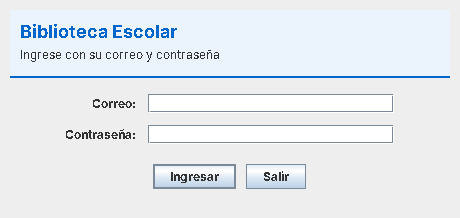
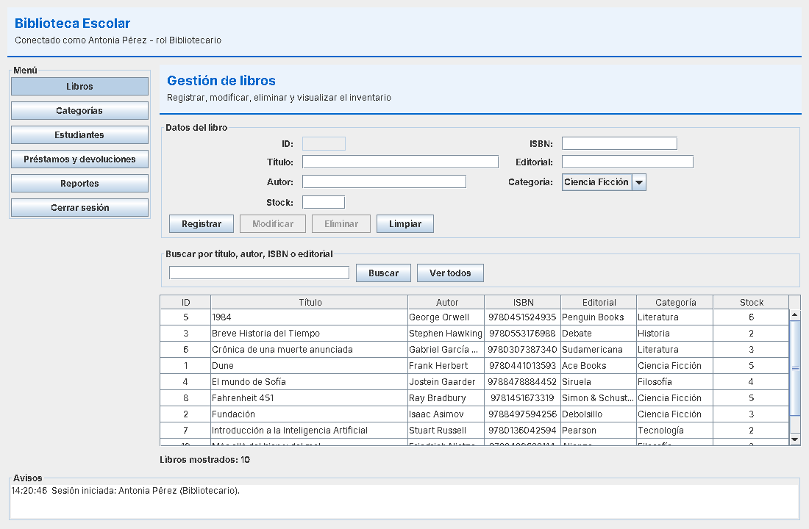
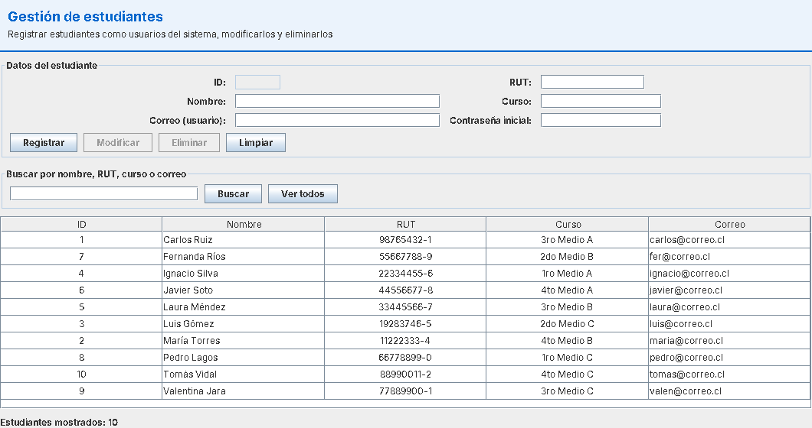
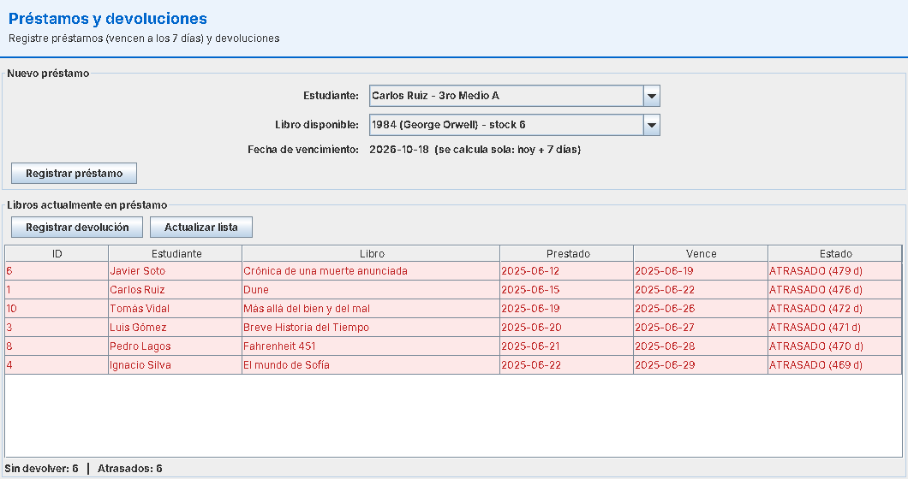
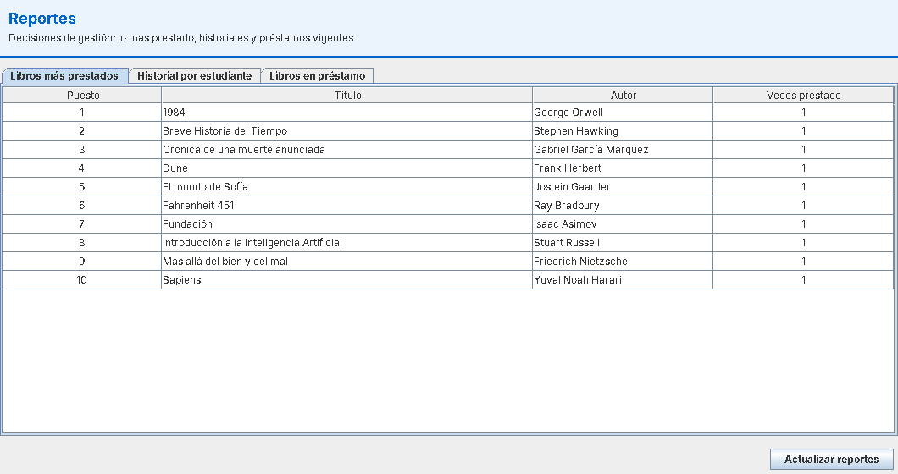
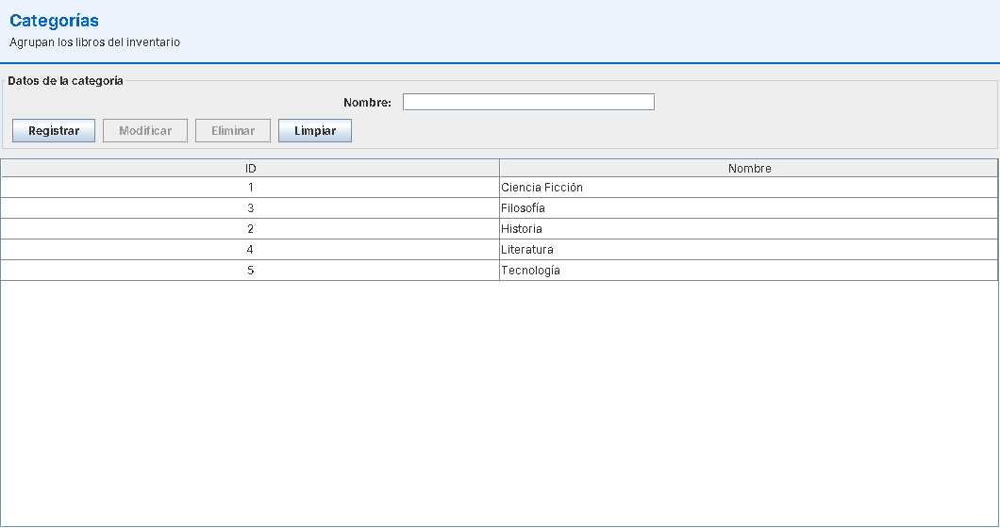
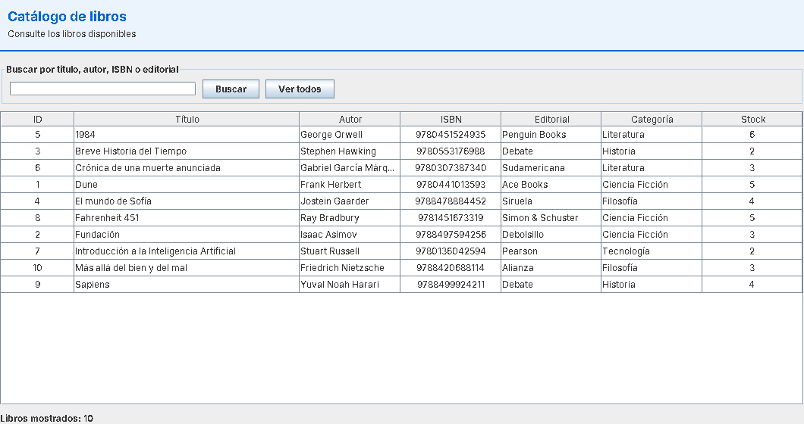
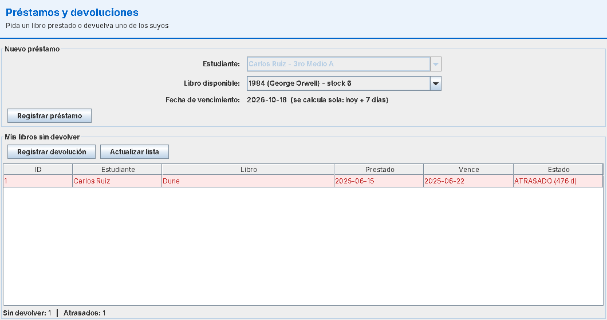
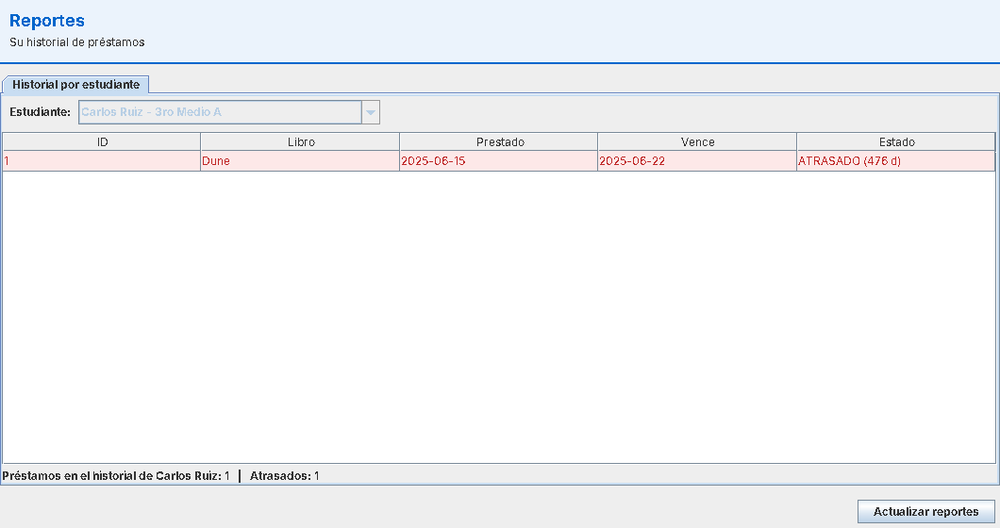

# Biblioteca Escolar – Evaluación Final Transversal (Desarrollo Orientado a Objetos II)

Aplicación de escritorio en **Java 17 + Swing (JFrame)** con persistencia en **MySQL vía JDBC** para gestionar el
préstamo de libros de una biblioteca escolar. Autor: Rodolfo Delgado (rodo.delgado@duocuc.cl).

## Funcionalidades

| Rol | Puede hacer |
|---|---|
| **Bibliotecario** | CRUD de libros y categorías, registro/edición/eliminación de estudiantes, registrar préstamos y devoluciones de cualquier estudiante, ver todos los reportes |
| **Estudiante** | Ver el catálogo, pedir libros prestados, devolver **sus** libros, ver sus propios préstamos y reportes |

Reglas de negocio: plazo de 7 días, máximo 3 préstamos activos por estudiante, no se puede prestar dos veces el mismo
libro a la misma persona, no se presta sin stock, los atrasos se calculan (préstamo no devuelto y fecha actual mayor que el vencimiento).
Reportes: libros disponibles, préstamos activos, atrasados, historial por estudiante y libros más prestados.

## Arquitectura

```
src/main/java
├── modelo       Persona (abstracta) → Estudiante, Usuario (abstracta) → Bibliotecario / UsuarioEstudiante,
│                interfaces Autenticable y Prestable, Libro, Categoria, Prestamo, Rol
├── dao          CrudDAO<T> genérico + interfaces por entidad; dao/impl con JDBC (PreparedStatement)
│                DatabaseConnection = Singleton de la conexión
├── controlador  Lógica de negocio (validaciones, reglas, sincronización). La vista nunca toca el DAO.
├── tareas       TareaSegundoPlano<T>: hilo para préstamos/devoluciones sin congelar la interfaz
├── vista        JFrames y paneles Swing
├── util         Validador (RUT, correo, textos)
└── main         Main + Aplicacion (raíz de composición: arma DAOs, controladores y ventanas)
```

* **MVC**: vista (Swing) ↔ controlador ↔ modelo/DAO.
* **DAO**: todo el SQL vive en `dao/impl`; los controladores dependen de interfaces (se prueban con DAOs falsos).
* **Singleton**: `DatabaseConnection.getInstance()` entrega una única conexión (se reconecta si se cae) y serializa su uso.
* **Polimorfismo / abstracción / interfaces**: permisos por rol como métodos sobrescritos (`Bibliotecario` vs `UsuarioEstudiante`),
  clases abstractas `Persona` y `Usuario`, `Libro` implementa `Prestable` y `Usuario` implementa `Autenticable`; `Estudiante` y `Usuario` heredan de `Persona`.
* **Concurrencia**: cada préstamo/devolución corre en un hilo (`TareaSegundoPlano`) y el resultado vuelve al hilo de Swing
  con `SwingUtilities.invokeLater`. El método `ControladorPrestamos.registrarPrestamo` es `synchronized` y además la base
  descuenta el stock con `UPDATE libros SET stock = stock - 1 WHERE id = ? AND stock > 0` dentro de una transacción, por lo que
  dos usuarios pidiendo el último ejemplar nunca generan stock negativo (hay una prueba que lo demuestra con 30 hilos).
* **Seguridad**: solo `PreparedStatement` (sin concatenar SQL).

## Requisitos

* JDK 17 o superior
* Maven 3.8+ (solo para compilar)
* MySQL 8 (o MariaDB) en ejecución

## Puesta en marcha

1. **Base de datos**: en MySQL ejecutar, en este orden, los scripts de la carpeta `bd/`:
   1. `Script_crea_tablas_biblioteca.sql` (crea la base `biblioteca` y las tablas)
   2. `Script_poblado_tablas_biblioteca.sql` (datos de ejemplo)
2. **Credenciales**: copiar `db.properties.example` como `db.properties` (misma carpeta) y poner tu usuario y contraseña de MySQL.
   Ese archivo está en `.gitignore`.
3. **Compilar**: `mvn clean package` → genera `target/biblioteca-escolar.jar` (ejecutable, con el driver incluido).
4. **Ejecutar**: `ejecutar.bat` (Windows) o `java -jar target/biblioteca-escolar.jar`.

### Usuarios de prueba (datos del script del profesor)

| Rol | Correo | Contraseña |
|---|---|---|
| Bibliotecario | antonia@correo.cl | clave123 |
| Estudiante | carlos@correo.cl | clave123 |
| Estudiante | maria@correo.cl | clave123 |

> Los préstamos de ejemplo tienen fecha 2025, por eso aparecen como atrasados en los reportes.

## Pruebas

`mvn test` ejecuta 43 pruebas JUnit 5:

* Pruebas de controladores con DAOs falsos (siempre se ejecutan): reglas de negocio, validaciones y concurrencia.
* Pruebas de DAO contra una base real **de pruebas**. Para ejecutarlas: cargar `bd/Script_base_pruebas.sql`
  (crea `biblioteca_test`), copiar `db-test.properties.example` como `db-test.properties`. Si no existe, se omiten;
  nunca tocan la base `biblioteca`.

## Capturas

**Inicio de sesión**



**Bibliotecario: libros**



**Bibliotecario: estudiantes**



**Bibliotecario: préstamos y devoluciones**



**Bibliotecario: reportes**



**Bibliotecario: categorías**



**Estudiante: catálogo, mis préstamos y mis reportes**






